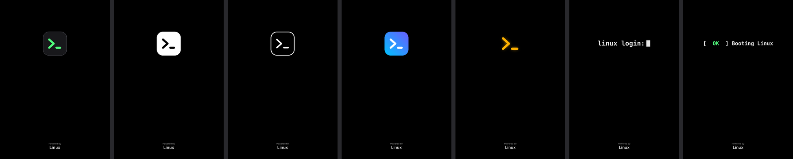
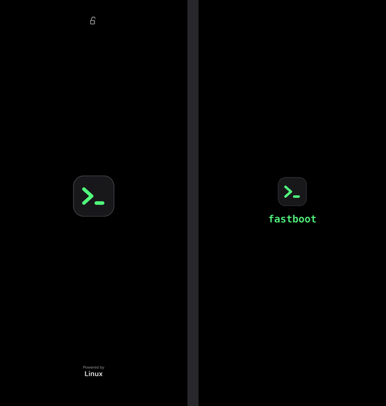
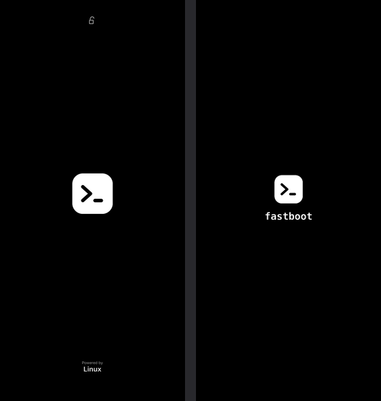
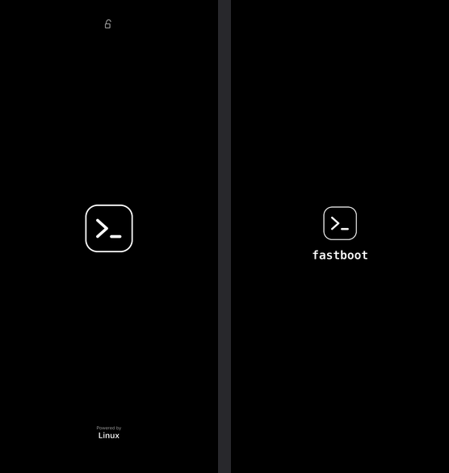
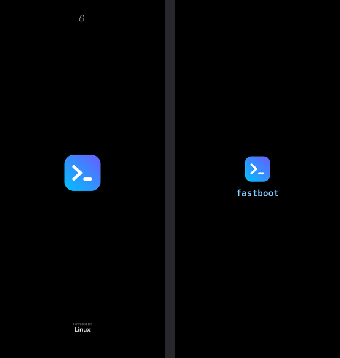
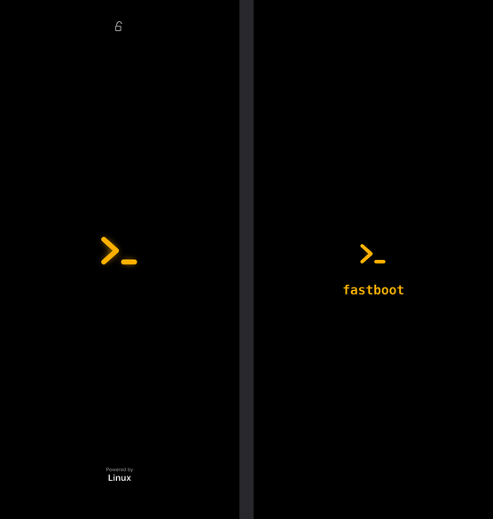
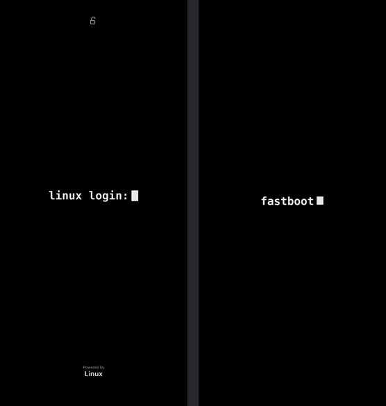
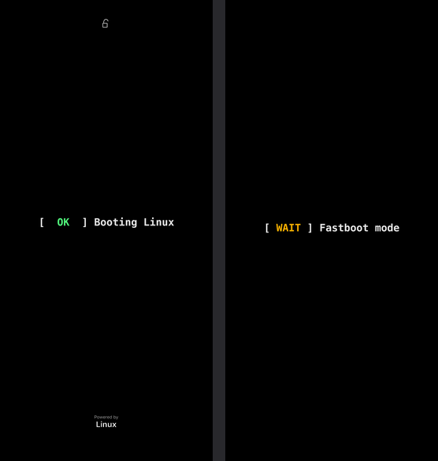
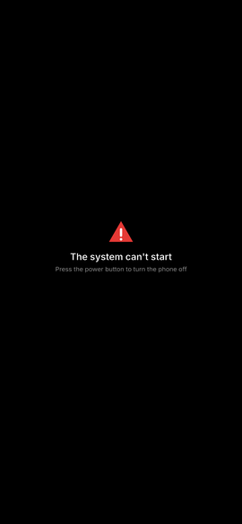

# xiaomi-logo-changer

Replace the Mi logo your Xiaomi phone shows while it starts, along with the
fastboot and error screens, with something of your own.



- **Seven designs**, or your own picture.
- **Three ways to apply it:** fastboot from a computer, a Magisk / KernelSU
  module on rooted Android, or directly on the phone if it runs Linux.
- **Safe to undo.** Only the pictures change, each written at exactly its
  original size and position, and there is always a way back to the
  original.

Ready-made files for the **Xiaomi Mi 10 (umi)** are on the
[Releases page](https://github.com/miercolesv/xiaomi-logo-changer/releases/latest).
For other Xiaomi phones, the tool builds them from your phone's own logo
image.

## Designs

Each design replaces the boot logo (left) and the fastboot screen (right).

| Design | | |
|---|---|---|
| `terminal-green` (default) |  | Dark tile with a green prompt |
| `terminal` |  | White tile with a black prompt |
| `outline` |  | Thin white outline, light and minimal |
| `gradient` |  | Blue-violet gradient tile, white prompt |
| `amber` |  | Glowing amber prompt, like an old terminal |
| `console` |  | A console login prompt with a cursor |
| `status` |  | A boot status line |
| `--image FILE` | | Any picture you like (PNG or JPEG, transparency works) |

On phones with an unlocked bootloader, the boot logo keeps the small open
padlock at the top: it's the bootloader's warning that the phone is unlocked.
Under the logo, "Powered by android" becomes "Powered by Linux" (change it
with `--footer`, or remove it with `--footer ""`). The error screen is
redrawn in the same style for every design:



## Xiaomi Mi 10: ready-made files

Download from the [Releases page](https://github.com/miercolesv/xiaomi-logo-changer/releases/latest):

- `mi10-<design>-fastboot.zip`: a complete `logo.img` to flash from a computer.
- `mi10-<design>-magisk.zip`: a module for a rooted phone; no computer needed.

These are for the Mi 10 (umi) only, and they contain no Xiaomi artwork: every
picture in them is redrawn.

### With fastboot (unlocked bootloader)

1. Unzip `mi10-<design>-fastboot.zip`.
2. Turn the phone off, then hold **Volume down + Power** until fastboot appears.
3. On the computer:

   ```sh
   fastboot flash logo logo.img
   fastboot reboot
   ```

To undo it, flash `logo.img` from the official fastboot ROM for your phone
(it's in the ROM's `images` folder), or your own backup of the partition.

### With Magisk or KernelSU (rooted Android)

1. Copy `mi10-<design>-magisk.zip` to the phone.
2. Magisk or KernelSU app → **Modules** → **Install from storage** → pick the zip.
3. Restart.

Before writing anything, the module checks that every picture is where it
expects it, and stops without changes if the phone's layout is different.
It then saves the original partition to
`/data/adb/xiaomi-logo-changer/logo-original.img`. **Removing the module puts
the original logo back.** To switch designs, remove the module, restart, then
install the other one.

## Any Xiaomi phone: build your own

You need Python 3 and Pillow (`pip install pillow`) on a computer, and the
phone's original `logo.img`. To get it, either:

- take `images/logo.img` from the official fastboot ROM for your phone and
  system version, or
- copy it off a rooted phone (USB debugging on):
  `python3 logo_changer.py pull -o logo.img`.

Then:

```sh
git clone https://github.com/miercolesv/xiaomi-logo-changer
cd xiaomi-logo-changer
python3 logo_changer.py build logo.img -o logo-new.img --design amber
```

It lists what it found in each picture and writes previews to
`logo-new-preview/` (open `overview.png`). **Check them before flashing.**
This was only tested on the Mi 10, so another phone's pictures may be read
differently. If one is, say which picture is which with `--logo`,
`--fastboot`, `--error` or `--keep` and the picture numbers it printed.

Then flash it:

```sh
fastboot flash logo logo-new.img       # A/B phones: logo_a and logo_b
```

or make a module for a rooted phone instead:

```sh
python3 logo_changer.py module logo.img -o logo-module.zip --design amber
```

Always build from the *original* `logo.img`, not one this tool already changed.

## Linux on the phone

For phones that run a regular Linux distribution (for example
[Arch Linux ARM on the Mi 10](https://github.com/miercolesvd/mi10-arch-linux)),
it writes the partition directly:

```sh
sudo pacman -S python-pillow           # or your distribution's Pillow package
curl -sL https://raw.githubusercontent.com/miercolesv/xiaomi-logo-changer/main/logo_changer.py | sudo python3 - install --design amber
```

The first time, it saves the partition to `~/logo-original.img`. Later runs
always draw on that original, so switching designs is just another
`install`. To put Xiaomi's logo back:

```sh
curl -sL https://raw.githubusercontent.com/miercolesv/xiaomi-logo-changer/main/logo_changer.py | sudo python3 - restore
```

## Options

| Option | Effect |
|---|---|
| `--design NAME` | One of the designs above (`logo_changer.py designs` lists them) |
| `--image FILE` | Your own picture instead of a design |
| `--text TEXT` | Text for the `console` and `status` designs, e.g. `--text "mi10 login:"` |
| `--footer TEXT` | The word under "Powered by" (default `Linux`; `""` removes the footer) |
| `--redraw-padlock` | Draw a new unlocked padlock instead of keeping the phone's |
| `--keep-fastboot`, `--keep-error` | Leave those screens as they are |
| `--logo N`, `--fastboot N`, `--error N`, `--keep N` | Say what picture N is, if it was read wrongly |

`logo_changer.py extract logo.img` saves every picture as a PNG, without
changing anything.

## How it works

A Xiaomi `logo` partition starts with a small table (`LOGO!!!!`), followed by
full-screen BMP pictures in fixed slots: on the Mi 10, eight pictures at
1080×2340. They are the boot logo with and without the padlock (three copies
each), the fastboot screen and an error screen. The tool finds the pictures,
works out what each one shows from where its bright areas are, and draws the
new picture over the old one: the logo and "Powered by" line are cleared and
redrawn, and everything else stays. Each new picture is written back in the
original's exact format and size, so the table and the rest of the partition
don't change.

## Licence

MIT, see [LICENSE](LICENSE). The bundled fonts are Inter (SIL Open Font
License 1.1) and DejaVu Sans Mono (Bitstream Vera licence); see `fonts/`.
Xiaomi and Mi are trademarks of Xiaomi Inc. This project is not affiliated
with Xiaomi.
