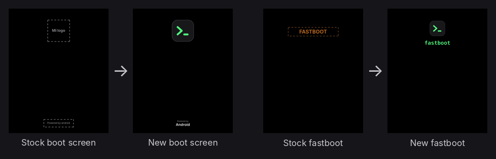
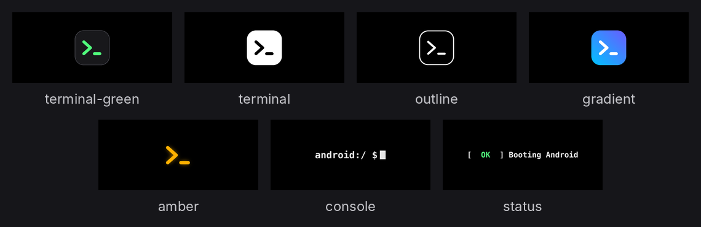

# xiaomi-logo-changer

Replace the Mi logo, fastboot screen and error screen of a Xiaomi phone with
one of seven designs, or your own picture. Works with stock MIUI or HyperOS,
custom ROMs, and Linux.



## Designs



Under the logo it says "Powered by Android". `--os linux` makes it "Linux",
and `--footer ""` removes it.

## Xiaomi Mi 10

Get your design from the
[Releases page](https://github.com/miercolesv/xiaomi-logo-changer/releases/latest).

**Fastboot** (unlocked bootloader): unzip `mi10-<design>-fastboot.zip`, then

```sh
fastboot flash logo logo.img
fastboot reboot
```

**Magisk or KernelSU** (rooted): install `mi10-<design>-magisk.zip` as a
module and restart. Removing the module brings the original back.

**Linux on the phone** (needs Pillow):

```sh
curl -sL https://raw.githubusercontent.com/miercolesv/xiaomi-logo-changer/main/logo_changer.py | sudo python3 - install --design amber
```

`restore` instead of `install` brings the original back.

## Other Xiaomi phones

Use the `logo.img` from your phone's official fastboot ROM:

```sh
pip install pillow
python3 logo_changer.py build logo.img -o logo-new.img --design amber
fastboot flash logo logo-new.img
```

Check the previews in `logo-new-preview/` before flashing: it has only been
tested on the Mi 10. Options, modules and details: [docs/usage.md](docs/usage.md).

## Licence

MIT. Fonts: Inter (SIL OFL 1.1) and DejaVu Sans Mono, see `fonts/`.
Not affiliated with Xiaomi.
