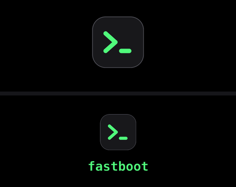
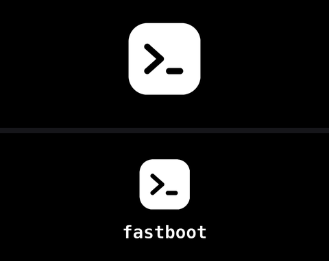
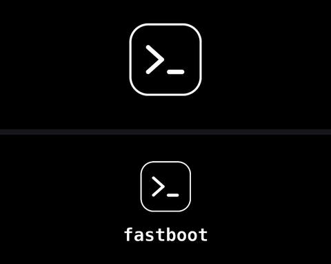
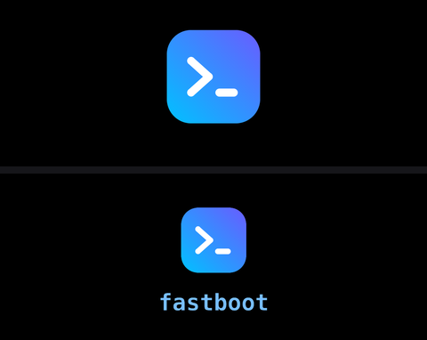
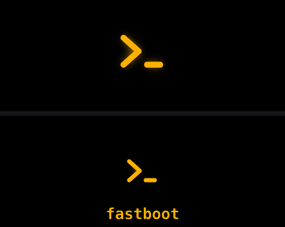
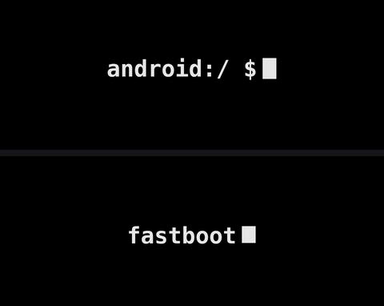
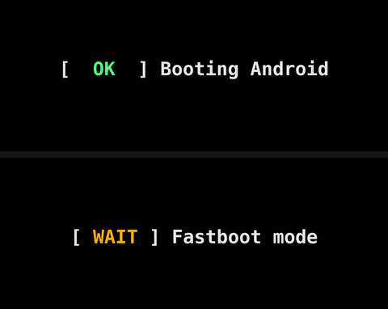
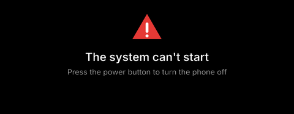

---
hide:
  - navigation
---

# Designs

Each design changes the boot logo (top) and the fastboot screen (below it).
Under the logo it says **Powered by Android**, or **Powered by Linux** if your
phone runs Linux.

-   **terminal-green** *(default)*

    ---

    { .shot }

    A dark tile with a green prompt.

-   **terminal**

    ---

    { .shot }

    A white tile with a black prompt.

-   **outline**

    ---

    { .shot }

    A thin white outline: light and minimal.

-   **gradient**

    ---

    { .shot }

    A blue-violet tile with a white prompt.

-   **amber**

    ---

    { .shot }

    A glowing amber prompt, like an old terminal.

-   **console**

    ---

    { .shot }

    A console prompt with a cursor.

-   **status**

    ---

    { .shot }

    A boot status line.

-   **Your own picture**

    ---

    Any PNG or JPEG, transparency included. See
    [the advanced guide](advanced.md#your-own-picture).

## The error screen

Every design redraws the error screen the phone shows when the system can't
start, in the same style:

{ .shot width="400" }

!!! tip "The little padlock"
    On a phone with an unlocked bootloader, a small open padlock appears at
    the top of the boot screen. It stays, because it's the bootloader's
    warning that the phone is unlocked. The ready-made files redraw it in the
    same style.
