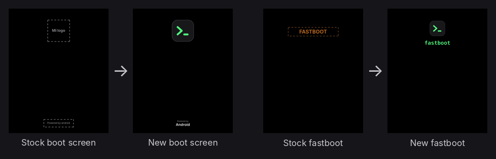

---
hide:
  - navigation
  - toc
---

# Give your Xiaomi a new face

Swap the Mi logo you see while your phone starts, along with the fastboot and error screens, for something you like.

{ .shot }

## How it works, in three steps

1. **Pick a design.** There are seven, or you can use your own picture. [See them all :material-arrow-right:](designs.md)

2. **Download it** for your way of installing: fastboot, Magisk or KernelSU, or Linux.

3. **Install it and restart.** That's it.

## Pick your way

-   :material-laptop:{ .lg } **With a computer**

    ---

    Flash it with `fastboot`. Needs an unlocked bootloader.

    [:material-arrow-right: Fastboot steps](install.md)

-   :material-cellphone-cog:{ .lg } **Rooted phone, no computer**

    ---

    Install a Magisk or KernelSU module from the app.

    [:material-arrow-right: Module steps](install.md)

-   :material-penguin:{ .lg } **Linux on the phone**

    ---

    One command, right on the phone.

    [:material-arrow-right: Linux steps](install.md)

-   :material-cellphone-text:{ .lg } **Another Xiaomi phone**

    ---

    Make your own files from your phone's `logo.img`.

    [:material-arrow-right: Advanced guide](advanced.md)

## Is it safe?

- **Only the pictures change.** Each new picture goes exactly where the old
  one was, at exactly the same size, so the phone reads them as before.
- **There's always a way back.** Every install method can put the original
  screens back. See [Undo](undo.md).
- **Ready-made files are for the Xiaomi Mi 10 (umi).** On other phones,
  build your own and check the previews first.
